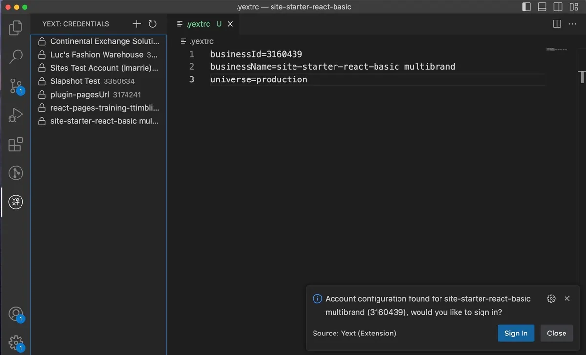

import FleetDemo from "../../components/FleetDemo.astro";

If I tilt my chair all the way back and look over my shoulder, I’m able to see the two tone matte blue 2023 [Fisker Ocean](https://en.wikipedia.org/wiki/Fisker_Ocean) at the bottom of the stairs — my favorite. The instrument panel of the manufacturer vehicle hangs open, wires spilling out like the exposed joists of the San Francisco office loft we work in. You wouldn’t know this truth from looking at my screen though. From the web app the car looks like any other in the fleet, patiently awaiting a command.

I set the back left window to 0, send, and lean back.

Looking down at the literal scrappy garage startup below me, I see the lights flash and the window rolls down. Nice, I give a slight nod back.

## The workbench

The dashboard is a [create-react-app](https://create-react-app.dev/) single-page application with [Material UI](https://mui.com/material-ui/) controls bolted on by more than a dozen engineers, each of whom cared only about adding that one more button… a few dozen times. The source is honestly a mess. Inputs are buried in deeply nested ternaries, making it hard to follow rendering logic. There are embedded engineers recalling their 100s-level MVC class opt for one big HTML block directly in the main component. Then the rest of us who are simply fine with our digital workbench: everything within reach, nothing put away.

Just like any other workbench in the throes of a big project, our dashboard looks unusable to those on the outside. My boss Gene glances over to get my attention. He’s moved over next to my physical desk as he’s gotten more involved in our digital one lately. “Our techs are going to need this to manage the vehicles at a fleet level. We can’t keep relying on them to connect into the cars individually.” he says.

I start the next day clicking around the app as if trying to familiarize myself more with the tool I use daily. To my surprise, I do see something new… My window control UI is missing. In its place sits a battery meter. A quick git-blame shows a name I don’t recognize, which also points to someone on powertrain. The code also shows my control is still there in code, but this new one incorrectly alters the code block so mine doesn’t render anymore. I decide to save the fix for next time I need to do something with the windows.

Hacked-together tools have a knack for surviving. Good ideas are hard to come by, and for an internal tool to get any repeat visitors it must be doing something right. In this case it was simply easier to look up a vehicle's state on the dashboard than to connect to the redis cluster, and it was easier to input 0 on the window control UI than to produce one in [kafka-ui](https://github.com/provectus/kafka-ui). It was also easier to fix a ternary hiding the control you need as needed than to maintain and support it as a reliable product. Nobody schedules a design review for a thing that isn't a product.

## The quick sync

A Slack from Jason “Hey, heard we’re building a vehicle dashboard. Wanted to set up a quick sync.” He somehow learns about everything, I think.

The quick sync is 40 min, and by the end of it the dashboard has a roadmap. Product wants to expose more to make it a full diagnostic tool for techs to use on the field. Design wants it to use their soon to be released design system (replacing the old design system, we weren’t using). Somebody has already written a doc titled Migrating Dashboard to Next.js, and the doc has a phase two.

On their own, individual ideas can be reasonable. That’s the trouble with scope creep. It might not be a bad idea, but with the direction of [design by committee](https://en.wikipedia.org/wiki/Design_by_committee), the product can end up being built for no one. It’s why so many people advocate for small autonomous teams. It’s difficult to say no in the workplace, leaving the product to die the tragic death of a thousand cuts.

## A fresh codebase

In this case, I agree to it and spend the next day with [Next.js](https://nextjs.org/). Starting with blocking out the routes for the new site. The inspiration is an email client, where a main searchable list gives way to a detail pane on the right. I hadn’t used Next.js before, outside of probing it for ideas and standards when building the site generator at Yext. It’s always enjoyable to start a fresh codebase and think of its possibilities.

By the late afternoon I have the three main routes I need, and the detail pane is properly wired up to work within the main layout while controlling the page history. Aside from that I think about what isn’t done. Supposedly we can install the design system and use it out of the box, but it probably doesn’t have the extent of the controls we need. Building them will take cooperation with design. Even when we do lay out the page controls, populating its data will be a greater task. Next.js has some expectations of prefetching static data and streaming live data along another path. I’d hate to do this migration and continue polling as much as we were.

## Back at Yext

I’m reminded again of [Yext](https://www.yext.com/). Developers there would often juggle between several customer accounts. Switching between them was tedious, but forgetting to was worse. At the time, I had felt overwhelmed by an increasing number of “one-stop” and “full self-service” tools we were building for things like this. My solution was to add a .yextrc file in every customer repository and a build step to handle account management off that. Afterwards, I noticed coworkers weren’t trusting it, and continued to manually manage credentials. It needed some visual confirmation. This is when I wrote the [Yext VS Code plugin](https://github.com/tatimblin/vscode-yext). VS Code was the perfect surface to build on, developers were already in the application and (after installing) wouldn’t have to remember that “one simple trick” I was trying to avoid. The tool worked exceptionally well, I went through a few versions testing it, released it, then never updated it again.

It was because it couldn’t be anything other than a VS Code extension. There was no styling to iterate on, systems to construct, or really any other tangents for me to go down. I briefly think to myself what rebuilding the Yext dashboard in VS Code would look like. There was also no direction for a PM to give, or UX for a designer to research. VS Code is a well trodden path and implementing account management fit well into it. The resulting tool felt small and complete from an early stage. This is what we needed at [Fisker](/txt/why-i-joined-fisker).

## The pitch

I bring Gene a new direction. The dashboard, as a VS Code extension. The model works exceptionally well and pitches itself. I start with “A list of cars makes up the file tree, searching for a car would work just like searching for a file”. He pretty much gets it at this point, but I continue “Opening a car shows a controls page using the VS Code elements. It could also be opened as editable JSON where we could make config edits”. Proving he gets it, Gene finishes the pitch for me “And we can use the terminal viewer for streaming CANBus signals”. “Exactly!” I exclaim. We make the decision fast and I move on to working on a demo.

<FleetDemo />
